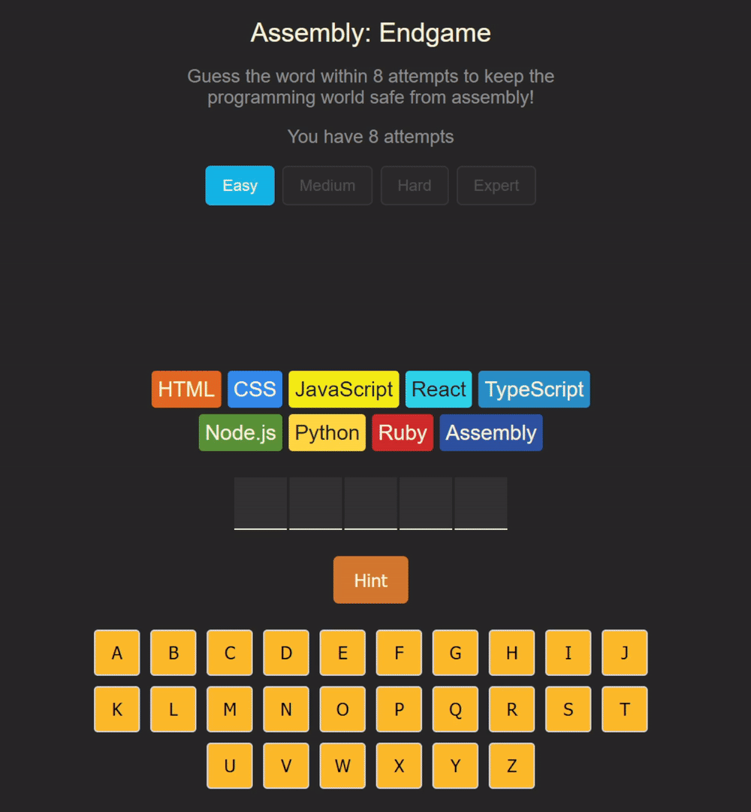
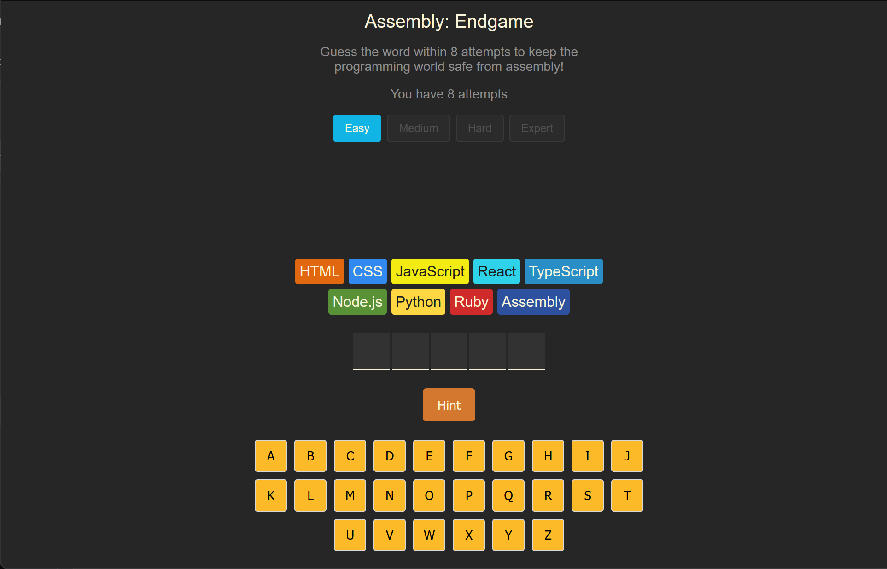

# Hangman (Assembly: Endgame)

English | [简体中文](README.zh-CN.md)

A word-guessing game built with React + Vite. Keep the programming world safe from Assembly by guessing words before all 8 of your language chips are eliminated!

[](./media/demo.mp4)

## Live Demo

<a href="https://gotham-citizen.github.io/Hangman/">
  
</a>

Click the image above or [here](https://gotham-citizen.github.io/Hangman/) to try it!

## Features

- 🎮 Classic hangman gameplay with an on-screen keyboard
- ⌨️ Physical keyboard support — press A–Z to guess while the on-screen keys stay in sync
- 🗑️ 8 programming languages as "chips" — each wrong guess eliminates one with a farewell message, leaving `Assembly` as the final boss
- 📈 4 difficulty levels (Easy / Medium / Hard / Expert) — words get longer as difficulty rises (5 → 6 → 7 → 8-9 letters)
- 💡 Hint system — reveal the word's category (animal, food, body part, action, etc.)
- 🏆 Win-streak progression — win 3 rounds in a row to unlock the next difficulty level
- 🥇 Best-streak tracking — your longest winning streak is remembered and matched once a round ends
- 💾 Full progress is saved to `localStorage` — difficulty, current word, guesses, win streak, and best streak all persist between sessions
- 🎉 Win/lose states with confetti animations (react-confetti)
- ♿ Accessibility support — screen-reader live announcements, localized `<html lang>`, dialog focus trapping, and visible focus states
- 📱 Fully responsive layout — fluid sizing scales from small phones to desktop
- 🌐 Multi-language UI (English / 简体中文 / Español), auto-detected from the browser language via react-i18next

## Tech Stack

- [React 19](https://react.dev)
- [Vite](https://vite.dev)
- [react-i18next](https://react.i18next.com) — internationalization
- [clsx](https://github.com/lukeed/clsx) — conditional class names
- [react-confetti](https://github.com/alampros/react-confetti) — celebration animations

## Getting Started

```bash
# Install dependencies
npm install

# Start the dev server
npm run dev

# Build for production
npm run build

# Run ESLint
npm run lint
```

## Project Structure

```
components/
├── Chip.jsx                 # Programming language chip component
├── DifficultySelector.jsx   # Difficulty level buttons
├── GameStatus.jsx           # Win/lose/farewell status messages
├── Keyboard.jsx             # On-screen keyboard
├── LevelUpModal.jsx         # Level-up confirmation dialog
├── WinProgressModal.jsx     # Win-progress hint dialog
└── WordDisplay.jsx          # Hidden-word letter boxes
src/
├── App.jsx                  # Main game component (state + logic)
├── constants.js             # Shared constants (difficulty order, alphabet, win threshold)
├── languages.js             # Language chip data
├── words.js                 # Word list with categories
├── utils.js                 # Difficulty → word-length map & random word picker
├── storage.js               # localStorage load/save helpers
├── index.jsx                # App entry point
├── index.css                # Global styles
├── hooks/
│   └── useWindowSize.js     # Responsive window-size hook
└── utils/
    ├── i18n.js              # i18next configuration
    └── locales/
        ├── en/translation.js  # English translations
        ├── es/translation.js  # Spanish translations
        └── zh/translation.js  # Chinese translations
```

## Gameplay

1. A random word is picked from `src/words.js` based on the current difficulty (Easy: 5 letters, Medium: 6, Hard: 7, Expert: 8-9).
2. The player guesses letters using the on-screen keyboard or their physical keyboard (A–Z).
3. Each correct guess reveals the letter in the word; each wrong guess "eliminates" a programming language chip with a farewell message.
4. The game is lost when 8 chips are gone (Assembly remains as the boss), and won once every letter in the word has been guessed.
5. After a win, the winning streak increases — reach 3 consecutive wins to unlock the next difficulty level.
6. Your best streak is tracked and shown in the header once a round finishes.
7. Stuck? Use the **Hint** button to reveal the word's category.